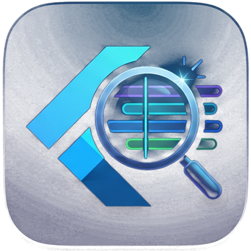

Analyzer. This is a tool, not an example. The window icon is [brand/icon.png](../../brand/icon.png).

Select file opens one recording, the session file `tool/play.dart` writes. The screen shows that scenario, the git commit stored with it, and each step with the widgets that rebuilt.

Add result opens another recording beside the first. Two recordings share a widget row and print the same reading as `tool/compare.dart`. A third recording stays in that same row. On a step with frame times, the shortest time is marked best and the longest is marked worst. Equal tenths of a millisecond stay unmarked. One recording has no mark.

Export taps writes the scenario the recording stored, or the taps a manual run recorded.

```bash
flutter run -d windows
```

The Windows installer that includes this app is in [docs/windows.md](../../docs/windows.md).
